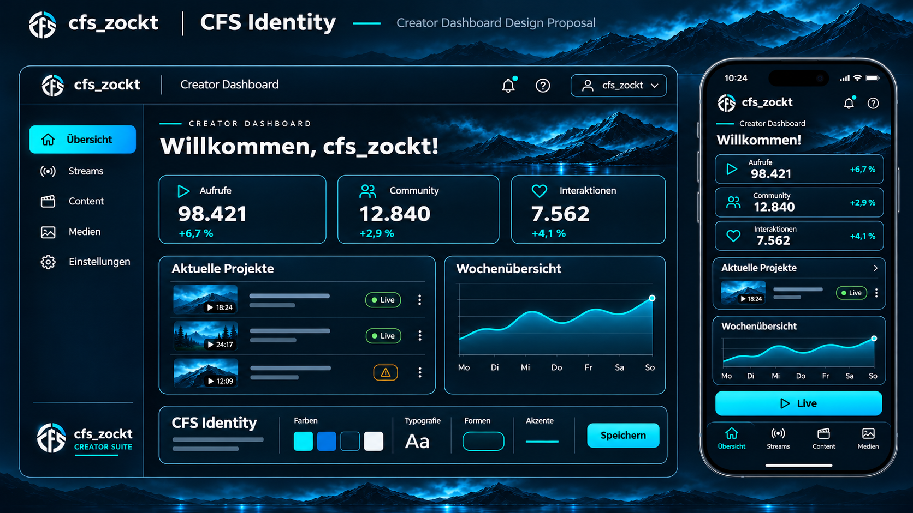

# CFS Identity – visueller Vorschlag V1

**Status:** Freigabevorschlag, noch keine websiteweite Umsetzung  
**Basis:** Arctic Signal + Creator-Grid-Arbeitsflächen  
**Logo:** bereitgestelltes CFS-Logo, unverändert und verbindlich

## Was der Vorschlag festlegt

- Eine gemeinsame Produktwelt für öffentliche Website, Launcher, Creator Dashboard, Stream Studio, Widget Studio, Cut Studio und Admin.
- Das Logo bleibt unverändert. Es wird nicht nachgezeichnet, verformt, neu eingefärbt oder durch ein generiertes Ersatzlogo ersetzt.
- Desktop nutzt eine ruhige Studio-Navigation mit klaren Arbeitsflächen; iPhone nutzt dieselben Begriffe und Komponenten in einer kompakten Bottom-Navigation.
- Berg-/Wasserbilder bleiben atmosphärischer Hintergrund und werden nicht als dekoratives Rauschen über jede Karte gelegt.
- Cyan markiert Aktion, Fokus und Live-Zustand; Amber ist ausschließlich für Warnungen reserviert.

## Vorläufige Design-Tokens

| Token | Wert | Verwendung |
|---|---|---|
| `--cfs-ink` | `#061522` | Seiten- und App-Hintergrund |
| `--cfs-surface` | `#0B2438` | Karten, Navigation, Panels |
| `--cfs-cyan` | `#11D7F2` | Primäraktion, Fokus, aktive Linie |
| `--cfs-blue` | `#168BDB` | sekundäre Aktion und Datenvisualisierung |
| `--cfs-text` | `#F3F7FA` | Primärtext |
| `--cfs-muted` | `#9EB2C2` | Metadaten und Hilfetext |
| `--cfs-warning` | `#F4A51C` | Warnung, nicht als Markenakzent |
| Radius | `14px` Karten / `10px` Controls | wiederkehrende Formensprache |
| Kontur | `1px` cyan/blau mit niedriger Opazität | Karten und aktive Controls |
| Bewegung | `160–220ms`, ease-out | Hover, Fokus, Panelwechsel |

## Typografie

Die V1 nutzt eine geometrische Display-Schrift für Titel und eine neutrale Sans für Text, Tabellen und technische Werte. Vor der Implementierung werden Lizenz, lokale/systemnahe Fallbacks, Ladegewicht und iPhone-Lesbarkeit geprüft. Keine Schrift wird aus dem Mockup ungeprüft extern eingebunden.

## Freigabepunkt

Bitte bestätige vor der Umsetzung:

1. **Freigabe V1** – Desktop-/iPhone-Richtung, Farben, Kartenkontur und Studio-Navigation passen.
2. **Korrekturschleife** – konkrete Änderung an Palette, Dichte, Bildanteil oder Navigation.

Erst nach Freigabe werden Design-Tokens und Komponenten in einem separaten Entwicklungs-PR implementiert. Neon-, Backup- und Produktionsgrenzen bleiben dabei unverändert.

